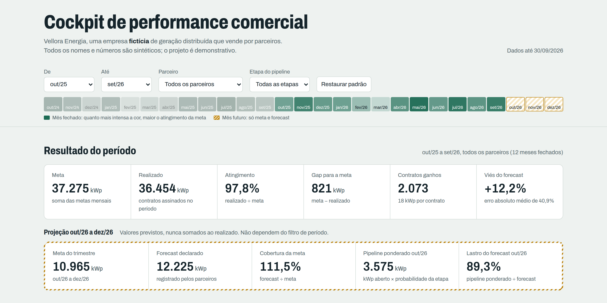

# Cockpit de performance comercial

Projeto de portfólio em Inteligência Comercial: um painel que acompanha meta, realizado, forecast, funil e riscos de uma operação que vende por parceiros.

> **Dados 100% fictícios.** A empresa "Vellora Energia" e seus 20 parceiros não existem. Toda a base foi gerada por simulação (`data/gerar_dados.py`). Nenhum dado, nome, logotipo ou layout de empresa real foi usado.



## O problema

Uma empresa de geração distribuída solar vende por meio de parceiros comerciais. A gestão precisa responder, todo mês, a perguntas como:

* Estamos na meta? Quem está puxando o resultado para baixo?
* O forecast que os parceiros declaram é confiável? Ele tem lastro no pipeline?
* Em que etapa do funil as oportunidades se perdem, e por quê?
* Quais oportunidades estão paradas, vencidas ou com pendência e merecem ação esta semana?

Quando essas respostas ficam espalhadas em planilhas, o realizado se mistura com a projeção, os números de uma visão não batem com os de outra e o diagnóstico depende de quem monta o relatório.

## A solução

Uma aplicação web estática, sem servidor, que lê a base em CSV e calcula tudo no navegador:

| Bloco | O que mostra |
|---|---|
| Resultado do período | Meta, realizado, atingimento, gap, contratos e viés do forecast histórico. |
| Projeção | Meta do trimestre seguinte, forecast declarado, cobertura, pipeline ponderado e lastro do forecast. Visualmente separado do realizado. |
| Evolução mensal | Meta, realizado e forecast registrado nos meses fechados; forecast e pipeline ponderado nos meses futuros. |
| Desempenho por parceiro | Ranking de atingimento e tabela ordenável com 11 indicadores e alertas. Clicar em um parceiro filtra o painel. |
| Funil comercial | Conversão da coorte criada no período, pipeline aberto por etapa e motivos de perda. |
| O que merece atenção | Alertas por parceiro (com a regra que os disparou), oportunidades com sinal de risco e negociações prioritárias do próximo mês. |
| Conclusões gerenciais | Diagnóstico e ações sugeridas, gerados por regras a partir dos números do filtro atual. |

**Filtros:** período (seletores ou clique em dois meses na linha do tempo), parceiro e etapa. O estado vai para a URL, então uma visão filtrada pode ser compartilhada por link.

### Regra visual

Cor sólida verde significa que aconteceu (realizado). Âmbar hachurado significa previsão (forecast, pipeline ponderado). As duas coisas nunca aparecem somadas no mesmo número.

## Como funciona

```
data/*.csv ──► assets/engine.js ──► assets/app.js ──► tela
                    │
                    └─► validacao/exportar_kpis_app.js ──► kpis_app.json ─┐
data/*.csv ─────────────────────────► validacao/validar_kpis.py ◄────────┘
```

* `assets/engine.js` concentra **todos** os cálculos em funções puras. A interface só formata e desenha o que o motor devolve.
* O mesmo motor roda no Node. `exportar_kpis_app.js` executa 7 cenários de filtro e grava os resultados.
* `validar_kpis.py` recalcula os mesmos indicadores com pandas, de forma independente, compara número a número e roda testes de integridade da base.

* `testar_interface.py` abre o painel num navegador headless e confere os KPIs exibidos e os dados desenhados no gráfico mensal contra o recálculo Python.

Última execução: **47 de 47 testes OK, 1.163 valores comparados entre motor e recálculo e 7 cenários conferidos na tela renderizada, sem divergência.** Relatório em [`validacao/relatorio_validacao.md`](validacao/relatorio_validacao.md).

Definições, fórmulas, regras de alerta e premissas da simulação: [`docs/dicionario_de_dados.md`](docs/dicionario_de_dados.md).

## Principais conclusões (visão padrão: out/25 a set/26, todos os parceiros)

Os números abaixo descrevem a base fictícia e servem para mostrar o tipo de leitura que o painel permite.

1. **Resultado perto da meta, com gap concentrado.** Realizado de 36.454 kWp contra meta de 37.275 kWp (97,8%). Ingá, Cambará e Pitanga concentram 48% da soma dos gaps individuais.
2. **O forecast tende a ser otimista e impreciso no nível do parceiro.** O forecast registrado no início de cada mês ficou 12,2% acima do realizado, com erro absoluto médio de 40,9% por parceiro-mês. Ingá, Manacá, Murici e Sapucaia ficaram mais de 25% acima.
3. **O trimestre seguinte está coberto no papel, mas não em todo parceiro.** O forecast de out a dez/26 cobre 111,5% da meta. Para outubro, o pipeline ponderado sustenta 89,3% do forecast no total, mas menos de 60% em Embaúba, Pitanga e Vinhático.
4. **Duas quedas pedem diagnósticos diferentes.** Ingá e Manacá caíram cerca de 34% nos últimos 3 meses. Em Ingá a criação de oportunidades também caiu (−16%), o que aponta para originação; em Manacá ela subiu (+14%), o que aponta para conversão.
5. **Um gargalo específico.** No parceiro Oiti, metade do kWp aberto tem sinal de risco, a principal pendência é o parecer de acesso da distribuidora e a conversão Negociação → Contrato é 22,7 p.p. abaixo da média do canal.

## Decisões que o painel apoia

* Onde concentrar o acompanhamento do mês (parceiros com maior gap e com alertas).
* Que forecast revisar antes do fechamento (viés histórico alto ou lastro baixo no pipeline).
* Que hipótese investigar primeiro quando um parceiro cai (originação ou conversão).
* Que oportunidades destravar (paradas, vencidas ou com pendência, ordenadas por kWp ponderado).
* Que negociações proteger até a assinatura (prioritárias do próximo mês).

O painel não mede o efeito dessas decisões; ele organiza a informação para tomá-las.

## Executar localmente

Os navegadores bloqueiam a leitura de CSV quando a página é aberta direto do disco, então é preciso um servidor local:

```bash
cd cockpit-performance-comercial
python -m http.server 8000
# abrir http://localhost:8000
```

Regerar a base e validar:

```bash
pip install -r requirements.txt
python data/gerar_dados.py               # recria os CSV (mesma semente = mesma base)
node validacao/exportar_kpis_app.js      # números calculados pelo motor da interface
python validacao/validar_kpis.py         # integridade + comparação; código de saída 1 se algo falhar
python validacao/testar_interface.py     # opcional (Playwright): confere KPIs e gráficos renderizados na tela
```

## Publicar no GitHub Pages

1. Crie um repositório público no GitHub, por exemplo `cockpit-performance-comercial`.
2. Envie o conteúdo desta pasta para a raiz do repositório:
   ```bash
   git init
   git add .
   git commit -m "Cockpit de performance comercial (dados fictícios)"
   git branch -M main
   git remote add origin https://github.com/SEU-USUARIO/cockpit-performance-comercial.git
   git push -u origin main
   ```
3. No repositório, abra **Settings → Pages**. Em *Build and deployment*, escolha *Deploy from a branch*, branch `main`, pasta `/ (root)`, e salve.
4. Em um ou dois minutos o painel fica disponível em `https://SEU-USUARIO.github.io/cockpit-performance-comercial/`.
5. Teste o link em uma janela anônima e no celular antes de publicar no LinkedIn.

O arquivo `.nojekyll` na raiz faz o GitHub Pages servir os arquivos como estão. Não há etapa de build: biblioteca de gráficos e fonte estão versionadas em `assets/`.

## Estrutura

```
index.html                    página do painel
assets/engine.js              motor de cálculo (navegador e Node)
assets/app.js                 interface, filtros e gráficos
assets/style.css              estilos (tema claro e escuro)
assets/vendor/                Chart.js 4.4.1 (MIT)
assets/fonts/                 Archivo (SIL Open Font License)
data/gerar_dados.py           simulação da base fictícia
data/*.csv                    base fictícia
docs/dicionario_de_dados.md   tabelas, fórmulas, regras e premissas
validacao/                    cenários, exportador do app, validador Python e relatório
screenshots/                  capturas em alta resolução
apresentacao/                 apresentação de 5 slides (.pptx)
```

## Tecnologias

HTML, CSS e JavaScript sem framework; Chart.js para os gráficos; Python (pandas, NumPy) para gerar a base e validar os cálculos; Node.js para executar o motor fora do navegador; Playwright para as capturas de tela.

## Limitações

* **Dados simulados.** As distribuições foram calibradas para parecer plausíveis, não para representar um mercado real. Algumas situações foram embutidas de propósito (descritas no dicionário de dados).
* **Conversão por coorte com censura.** Oportunidades ainda abertas contam só até a etapa atual, o que reduz as taxas das etapas finais em coortes recentes.
* **Probabilidades por etapa fixas**, calibradas no histórico do canal inteiro. Não variam por parceiro, segmento ou tamanho do projeto.
* **Lastro calculado só para o mês seguinte**, porque o ciclo de venda simulado é curto.
* **Pipeline é uma foto da data de corte.** Não há histórico de etapas por oportunidade, então não é possível reconstruir o pipeline de meses anteriores nem medir a acurácia do pipeline ponderado.
* **Regras de alerta com limiares fixos**, escolhidos para a demonstração. Em uma operação real seriam calibrados com a gestão.
* **Sem receita.** O volume está em kWp; o painel não estima faturamento ou margem.
* Base de 24 mil oportunidades carregada inteira no navegador; para volumes muito maiores seria preciso agregar antes.

## Próxima versão

* Histórico de mudanças de etapa por oportunidade (snapshots), permitindo pipeline de meses passados, tempo de ciclo por etapa e acurácia do pipeline ponderado.
* Probabilidades de ganho por parceiro e segmento, com intervalo de confiança.
* Faixa de forecast (pessimista, provável, otimista) em vez de um número único.
* Exportação da lista de riscos e dos alertas para planilha.
* Registro das ações tomadas por alerta, para medir depois se o resultado mudou.

---

Projeto demonstrativo. Todos os dados são fictícios.
